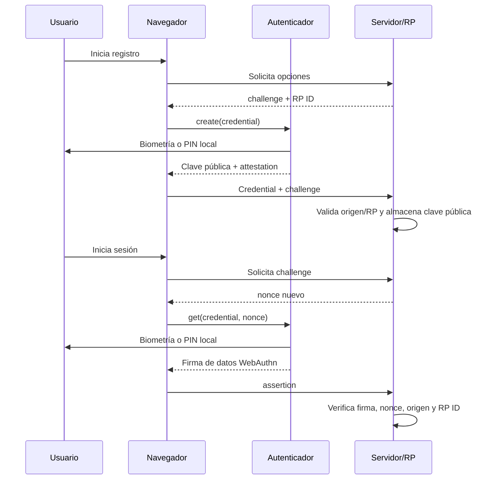

# Autenticación, Refresh Tokens Rotativos, Rate Limiting, Auth0 RBAC y Passkeys vs. TOTP

## Portada

**Estudiante:** Carlos Fernando Ligorria Flores  
**Carné:** 0902-22-7467  
**Curso:** Desarrollo web  
**Repositorio:** [tarea-autenticacion-0902-22-7467](https://github.com/cligorriaf-sketch/tarea-autenticacion-0902-22-7467) — enlace previsto; falta crear y publicar el repositorio en GitHub.  
**Archivo Word:** `Tarea-Autenticacion-0902-22-7467.docx`  
**Archivo PDF solicitado por la consigna para Canvas:** `Tarea-Autenticacion-0902-22-7467.pdf` (exportar el DOCX final si Canvas exige PDF).

---

## Parte 1: Refresh Tokens y Rate Limiting (`01-local`)

### 1.1 Diseño e implementación

El backend está en [`01-local/api`](./01-local/api) y el cliente React en [`01-local/web`](./01-local/web). La entidad [`RefreshToken`](./01-local/api/Models/RefreshToken.cs) conserva los siete campos requeridos. El índice único de `TokenHash` impide duplicados; la base SQLite recibe únicamente el SHA-256 hexadecimal del token presentado por el cliente. No se guarda ni se registra el token en claro.

```csharp
var refreshToken = Base64UrlEncoder.Encode(RandomNumberGenerator.GetBytes(32));
var hash = Convert.ToHexString(
    SHA256.HashData(Encoding.UTF8.GetBytes(refreshToken)));
```

El valor aleatorio tiene 256 bits y se codifica como Base64URL. El hash se busca en cada refresh y logout. El par emitido se serializa con las claves JSON `accessToken` y `refreshToken`; el access token dura 15 minutos y cada refresh token, siete días. La clave de firma se exige desde User Secrets y debe tener al menos 32 bytes.

La rotación reclama el token mediante una actualización condicional para evitar que dos solicitudes concurrentes emitan reemplazos del mismo registro. Si el registro ya fue revocado, se trata como reuse detection y se invalida la familia de sesiones:

```csharp
if (current.RevokedAt is not null)
{
    await RevokeActiveTokens(database, current.UserId, now, cancellationToken);
    await transaction.CommitAsync(cancellationToken);
    return Results.Unauthorized();
}

var claimed = await database.RefreshTokens
    .Where(token => token.Id == current.Id && token.RevokedAt == null && token.ExpiresAt > now)
    .ExecuteUpdateAsync(update => update.SetProperty(token => token.RevokedAt, now), cancellationToken);
if (claimed != 1)
{
    var latest = await database.RefreshTokens.AsNoTracking()
        .SingleOrDefaultAsync(token => token.Id == current.Id, cancellationToken);
    if (latest?.RevokedAt is not null)
    {
        await RevokeActiveTokens(database, latest.UserId, now, cancellationToken);
        await transaction.CommitAsync(cancellationToken);
    }

    return Results.Unauthorized();
}

current.RevokedAt = now;
var pair = await tokens.IssuePairAsync(current.UserId, cancellationToken);
var replacement = await database.RefreshTokens.SingleAsync(
    token => token.TokenHash == TokenService.HashRefreshToken(pair.RefreshToken),
    cancellationToken);
current.ReplacedByTokenId = replacement.Id;
await database.SaveChangesAsync(cancellationToken);
await transaction.CommitAsync(cancellationToken);
```

La API aplica el limitador nativo mediante particiones de dirección IP y fija explícitamente el status de rechazo:

```csharp
options.RejectionStatusCode = StatusCodes.Status429TooManyRequests;
options.AddPolicy("auth-fixed-window", context =>
    RateLimitPartition.GetFixedWindowLimiter(
        context.Connection.RemoteIpAddress?.ToString() ?? "unknown",
        _ => new FixedWindowRateLimiterOptions
        {
            PermitLimit = 5,
            Window = TimeSpan.FromMinutes(1),
            QueueLimit = 0,
            AutoReplenishment = true
        }));
```

En el flujo opcional de MFA, `/api/auth/login` verifica credenciales. Si hay un secreto TOTP configurado, responde `202 Accepted` con `twoFactorRequired` cuando todavía no recibe código; el cliente vuelve a presentar credenciales y código de seis dígitos en `/api/auth/2fa/verify`. También puede completar el MFA enviando `code` en el mismo login. Login emite el par solo tras validar todos los factores; `/api/auth/2fa/verify` igualmente devuelve el par una vez completada la verificación. Si el laboratorio no configura TOTP, login emite el par al validar la contraseña. Así no se expide un token de acceso antes de completar el segundo factor. La implementación usa intervalos TOTP de 30 segundos y acepta el paso actual y los adyacentes para tolerar desfase pequeño. Persiste el último paso aceptado por usuario en SQLite y rechaza su repetición. El limitador también reduce intentos; producción requiere enrolamiento verificado, límites adicionales por cuenta, alertas y recuperación segura.

La prevención de repetición se aplica atómicamente: SQLite guarda el último paso TOTP consumido por usuario y una actualización condicional solo acepta un paso posterior. Si el mismo código se vuelve a presentar dentro de su ventana, la verificación responde `401`.

`POST /api/auth/refresh` calcula el hash, busca el registro y distingue tokens inexistentes, expirados y revocados. Un token revocado indica posible reutilización: en una transacción se revocan todos los tokens todavía activos del mismo `UserId` y la respuesta es `401`. Un token válido se marca como revocado mediante una actualización condicional, se emite un reemplazo y se vincula mediante `ReplacedByTokenId`. `POST /api/auth/logout` revoca el token indicado y devuelve `200 OK`; repetir logout es idempotente.

El interceptor Axios en [`api.ts`](./01-local/web/src/api.ts) reintenta como máximo una vez cada petición original. Coordina refresh concurrentes en una única promesa compartida para no canjear simultáneamente el mismo token rotativo. El refresh usa Axios aislado, actualiza ambos tokens y reintenta la solicitud. Si falla, borra la sesión y redirige. El botón de cierre invoca logout antes de borrar los datos locales; si el servidor no responde, se comunica que la revocación remota no pudo confirmarse.

```javascript
if (error.response?.status === 401 && original.retryCount !== 1) {
  original.retryCount = 1;
  const { data } = await axios.post("/api/auth/refresh", {
    refreshToken: localStorage.getItem("refreshToken"),
  });
  localStorage.setItem("accessToken", data.accessToken);
  localStorage.setItem("refreshToken", data.refreshToken);
  original.headers.Authorization = `Bearer ${data.accessToken}`;
  return api(original);
}
```

#### Evidencias de Parte 1 — pruebas locales ejecutadas

Se ejecutó la API local con .NET 10 y configuración efímera fuera del repositorio. Las capturas son informes visuales de los resultados HTTP y la consulta SQLite obtenidos en la ejecución; los valores de access/refresh tokens, contraseña, secreto TOTP y código fueron omitidos. La base y las credenciales temporales se eliminaron al finalizar.

1. **Rotación exitosa:** [`refresh`](./01-local/evidence/refresh.png) — HTTP `200`, con los campos `accessToken` y `refreshToken` redactados.
2. **Reuse detection:** [`reuse`](./01-local/evidence/reuse.png) — el token anterior responde `401`; la consulta real muestra `26` tokens revocados y `0` activos para el usuario temporal.
3. **Rate limit de login:** [`login 429`](./01-local/evidence/rate-login.png) — respuestas `200, 200, 200, 200, 200, 429` desde la misma IP en menos de un minuto.
4. **SQLite:** [`hashes SQLite`](./01-local/evidence/sqlite.png) — hashes abreviados para lectura, longitud verificada de `64` caracteres hexadecimales y ninguna credencial en claro.
5. **Rate limit de 2FA:** [`2FA 429`](./01-local/evidence/rate-2fa.png) — cinco solicitudes llegan al endpoint y la sexta devuelve `429`. Las primeras cinco respondieron `401` porque esta prueba aislada medía el limitador sin secreto TOTP configurado.
6. **Flujo TOTP correcto y anti-replay:** [`verificación 2FA`](./01-local/evidence/totp-success.png) — login responde `202`, verificación responde `200`, la repetición del mismo código responde `401` y logout `200`. Se empleó un secreto efímero fuera del repositorio; no se mostró.

Los archivos [`01-local/requests.http`](./01-local/requests.http) y [`01-local/refresh-tokens.sql`](./01-local/refresh-tokens.sql) permiten repetir las pruebas. Para generar de nuevo capturas deben regenerarse las credenciales del entorno de laboratorio; los secretos temporales no se guardaron en el proyecto.

### 1.2 Rate Limiting por IP

ASP.NET Core usa la política nativa `FixedWindowRateLimiter`: máximo cinco solicitudes por ventana de un minuto, sin cola, particionadas por `RemoteIpAddress`. Se aplica a login y verificación 2FA y produce HTTP `429 Too Many Requests`. Para un despliegue detrás de un proxy, la dirección solo debe obtenerse de encabezados reenviados si el proxy está configurado como confiable; aceptar `X-Forwarded-For` arbitrario permitiría falsificar la partición.

`/api/auth/2fa/verify` necesita el mismo nivel de protección que login, o incluso mayor: un TOTP de seis dígitos tiene apenas 1,000,000 de valores posibles. Si el servicio permite una ventana temporal de más de un intervalo, cada intento puede tener más de un código candidato aceptable. Sin límites, un atacante puede automatizar intentos hasta acertar un código vigente, especialmente si tiene una contraseña ya comprometida. El rate limit reduce drásticamente la velocidad de prueba y también mitiga abuso de CPU/telemetría; no reemplaza límites por cuenta, demoras progresivas, alertas, bloqueo temporal, protección contra distribución de intentos ni invalidación de códigos ya usados. Aplicarlo solo al login dejaría abierto el endpoint que verifica el factor de posesión.

### 1.3 Notas de seguridad del cliente

El ejemplo utiliza `localStorage` para que el flujo académico se pueda inspeccionar. Es una elección de demostración, no una recomendación de producción: un XSS puede leer ambos tokens y un refresh token robado puede mantenerse utilizable hasta detectarse su reuse o expirar. Para una SPA real considere patrón BFF y refresh token en cookie `HttpOnly; Secure; SameSite`, acompañado de defensa CSRF, CSP estricta y HTTPS. No inserte tokens en URLs, logs ni capturas.

---

## Parte 2: Roles y permisos con Auth0 (`02-auth0`)

### 2.1 Configuración paso a paso en Auth0

1. En **Applications → APIs → Create API**, se creó la API `University Notes API`, con identifier/audience `https://university-notes-api` y algoritmo de firma **RS256**. Se utilizó un tenant de laboratorio nuevo (`dev-zr6osvtupoixpvyn.us.auth0.com`), no el tenant de clase.
2. Abra la API y su pestaña **Permissions**. Añada `read:messages` y `delete:messages`; guarde cambios. El permiso de borrado se configura explícitamente en esta API.
3. En los ajustes de la API, active **Enable Role Based Access Control (RBAC)** y **Add Permissions in the Access Token**; guarde. Con la segunda opción, Auth0 incluirá permisos asignados en el access token de la API bajo `permissions`.
4. En **User Management → Roles → Create Role**, cree `Lector`. En su sección de permisos, asigne únicamente `read:messages`.
5. Cree `Administrador`; asígnele `read:messages` y `delete:messages`.
6. En **User Management → Users**, seleccione dos usuarios de prueba diferentes. En **Roles → Assign Roles**, otorgue `Lector` a uno y `Administrador` al otro.
7. En **Applications → Applications**, cree/seleccione una aplicación de tipo **Single Page Application**. En sus ajustes, permita callback, logout y web origin para `http://localhost:5174`. Configure Domain, Client ID y Audience en `02-auth0/web/.env`; el Client ID es identificador público de cliente, no un secreto.
8. Configure `Auth0:Domain` y `Auth0:Audience` en User Secrets para la API. El frontend solicita un access token para la audiencia `https://university-notes-api` mediante Authorization Code + PKCE, decodifica `permissions` con `jwt-decode` y muestra el botón de eliminación solo si está presente `delete:messages`.

#### Evidencias de Parte 2 — tenant y pruebas reales

**Estado:** configuración y pruebas completadas en un tenant de laboratorio nuevo, creado con autorización del estudiante porque no se pudo acceder a un tenant de clase. No debe presentarse como el tenant de clase. Se configuraron la API `University Notes API`, los permisos `read:messages` y `delete:messages`, RBAC y la inclusión de permisos en el access token; se crearon los roles y dos usuarios de prueba distintos. No se guardaron contraseñas ni tokens completos en el proyecto o en las capturas. El Dashboard mostró una notificación de prueba temporal; no se proporcionó información de pago.

1. La API y sus permisos aparecen en [captura de permisos](./02-auth0/evidence/auth0-api-permissions.png); las opciones RBAC activadas, en [captura de configuración RBAC](./02-auth0/evidence/auth0-rbac-settings.png).
2. Los roles y permisos se muestran en las capturas de [roles](./02-auth0/evidence/auth0-roles.png), [permisos de Lector](./02-auth0/evidence/auth0-reader-permissions.png) y [permisos de Administrador](./02-auth0/evidence/auth0-administrator-permissions.png). Las asignaciones individuales están en [usuario Lector](./02-auth0/evidence/auth0-reader-user-role.png) y [usuario Administrador](./02-auth0/evidence/auth0-admin-user-role.png).
3. La aplicación muestra solo los permisos decodificados, no el JWT completo: [token de Lector](./02-auth0/evidence/auth0-reader-token-ui.png) (`read:messages`) y [token de Administrador](./02-auth0/evidence/auth0-admin-token-ui.png) (`read:messages`, `delete:messages`). El botón **Eliminar** está oculto para Lector y visible para Administrador.
4. La [captura de pruebas HTTP](./02-auth0/evidence/auth0-http-403-200.png) registra resultados reales: `GET /api/messages` como Lector → `200`; `DELETE /api/messages/1` como Lector, invocado directamente sin depender de la UI → `403 Forbidden`; `DELETE /api/messages/1` como Administrador → `200` con `{ "deleted": 1 }`.
5. El endpoint de borrado registra el claim `sub` y el identificador de mensaje mediante `ILogger`; la evidencia HTTP anterior acredita la autorización, no es una captura del log.

Los `401` identifican token ausente/inválido; `403` significa que el token fue autenticado, pero no contiene el permiso exigido. En los endpoints, la política `read:messages` protege GET y `delete:messages` protege DELETE. La comprobación de permisos se realiza del lado servidor sobre el claim `permissions`; el endpoint de borrado registra el claim `sub` con `ILogger`.

```csharp
options.AddPolicy("delete:messages", policy =>
    policy.RequireAuthenticatedUser().RequireAssertion(context =>
        context.User.FindAll("permissions")
            .Any(claim => claim.Value == "delete:messages")));

app.MapDelete("/api/messages/{id:int}", (int id, ClaimsPrincipal user, ILogger<Program> logger) =>
{
    if (!messages.TryRemove(id, out _))
    {
        return Results.NotFound();
    }

    var userId = user.FindFirst("sub")?.Value;
    logger.LogInformation("Usuario {UserId} eliminó el mensaje {MessageId}", userId, id);
    return Results.Ok(new { deleted = id });
}).RequireAuthorization("delete:messages");
```

### 2.2 Por qué ocultar un botón no es seguridad

La UI es código ejecutado en un dispositivo controlado por el usuario. Puede modificarse con DevTools, una extensión, un cliente HTTP distinto o una llamada construida manualmente. Decodificar un JWT en el navegador solo interpreta datos; no verifica criptográficamente firma, emisor, audiencia ni vigencia. Además, el JWT decodificado puede estar obsoleto o manipulado localmente. Por eso, esconder **Eliminar** es una mejora de experiencia y reduce errores accidentales, no una barrera de autorización.

El control efectivo está en cada endpoint del servidor: validar firma y claims del access token, validar audiencia/issuer y comprobar el permiso requerido antes de ejecutar la operación. Así, aunque un usuario lector revele o construya la ruta DELETE, la API responde `403`. El control UI debe reflejar las capacidades que comunica el servidor, pero nunca sustituirlas. Esta defensa por capas también evita que una llamada directa, un cliente móvil antiguo o una integración externa eluda una regla que solo existía en el frontend.

---

## Parte 3: Investigación — Passkeys vs. TOTP

### Funcionamiento y diagramas

Una **passkey** usa las APIs WebAuthn del navegador y el modelo FIDO2. Durante el registro, el servidor genera un desafío aleatorio de un solo uso, vinculado a la sesión y al dominio relying party (RP). El navegador entrega el desafío a un autenticador de plataforma —por ejemplo, TPM o Secure Enclave— o a una llave de seguridad externa. El autenticador crea un par asimétrico; la clave privada queda protegida por el autenticador y, para passkeys sincronizadas, por el mecanismo cifrado del proveedor. El servidor registra la clave pública junto a un identificador de credencial y el RP ID. Una biometría o PIN puede autorizar el uso local de la clave; no se envía la biometría al sitio. En el login, el servidor emite otro nonce, el autenticador firma los datos de cliente y autenticador que incorporan desafío, origen y RP ID, y el backend verifica la firma, el desafío, el origen y el hash del RP ID con la clave pública registrada (W3C, 2025).



**TOTP**, definido por RFC 6238, parte de un secreto simétrico `K` compartido entre el autenticador y el verificador. El dispositivo calcula el paso temporal `T = floor((CurrentTime - T0) / X)`, normalmente con `X = 30` segundos, y genera un valor truncado de HMAC sobre el contador, comúnmente HMAC-SHA1. El resultado se representa como seis u ocho dígitos. En el registro, el usuario incorpora `K` escaneando un QR (o introduciéndolo manualmente); servidor y dispositivo conservan el secreto. En cada autenticación ambos calculan el mismo código temporal y el servidor acepta el código dentro de una ventana pequeña para tolerar desfases de reloj (M’Raihi et al., 2011).

```mermaid
sequenceDiagram
    participant U as Usuario
    participant App as App autenticadora
    participant S as Servidor
    U->>S: Solicita alta de MFA
    S-->>U: QR con secreto K
    U->>App: Escanea QR; guarda K
    U->>S: Confirma código TOTP
    S->>S: Verifica HMAC(K,T)
    U->>S: Usuario/contraseña + código de 6 dígitos
    U->>App: Consulta código vigente
    App->>App: T=floor((CurrentTime-T0)/X); HMAC-SHA1(K,T)
    App-->>U: Código temporal
    U->>S: Envía código
    S->>S: Calcula y compara en ventana permitida
```

### Resistencia al phishing

WebAuthn vincula la credencial al RP ID y al origen verificado por el navegador. La firma incluye datos que permiten al servidor validar el challenge fresco, el hash del RP ID y el origen del cliente; la credencial de `campus.example` no sirve automáticamente en un dominio parecido. Un proxy inverso malicioso como Evilginx2 puede retransmitir una contraseña y un TOTP en tiempo real, y capturar la sesión resultante; el código es un secreto bearer que el usuario puede teclear en un sitio falso. El proxy no puede pedir a una passkey una firma válida para un RP ID distinto, siempre que el backend valide rigurosamente origen, audiencia, challenge y RP. Passkeys reducen sustancialmente phishing, aunque no eliminan riesgos de endpoints comprometidos, recuperación débil o ingeniería social (FIDO Alliance, s. f.; W3C, 2025).

### Experiencia de usuario y recuperación

Con passkey, el usuario elige “crear passkey”, confirma con biometría/PIN y después repite ese gesto para iniciar sesión. No necesita recordar ni copiar un código. La plataforma puede proteger claves con TPM en Windows o Secure Enclave en dispositivos Apple; también existen llaves FIDO2 externas que requieren presencia física y, según el modelo, PIN. Passkeys sincronizadas mediante iCloud Keychain o Google Password Manager facilitan el cambio de teléfono, mientras credenciales vinculadas a un dispositivo o llave física requieren registrar un segundo autenticador o completar recuperación. La sincronización ayuda a la usabilidad, pero introduce la seguridad de la cuenta del ecosistema y su recuperación como dependencia.

TOTP funciona en una gama amplia de servicios y teléfonos, pero exige instalar app, escanear/guardar QR y escribir un código que expira. Al cambiar de equipo, la transferencia segura entre autenticadores depende de su proveedor; reinstalar la app no siempre recupera `K`. Capturas de QR o exportaciones sin protección convierten el secreto compartido en una copia robable. En ambos métodos se necesitan alternativas: registrar más de una passkey, códigos de recuperación aleatorios de un solo uso almacenados fuera de línea, verificación de identidad proporcionada al soporte y revocación/auditoría de credenciales. Los códigos de recuperación son credenciales bearer: deben mostrarse una vez, almacenarse con cuidado, invalidarse al consumirse y regenerarse al sospechar exposición. Un fallback basado solo en contraseña o preguntas personales puede anular la ventaja antifishing del factor principal; debe protegerse con límites, alertas y un proceso de recuperación proporcional al riesgo (NIST, 2025).

### Recomendación para una app universitaria de notas

Recomendaría passkeys como método principal y TOTP como alternativa transitoria para usuarios cuyos navegadores, dispositivos institucionales o procesos de soporte aún no estén listos. La aplicación maneja notas académicas: el riesgo de phishing de credenciales universitarias justifica una autenticación resistente al origen. WebAuthn ya está integrado en navegadores y sistemas operativos modernos; la adopción puede ampliarse con credenciales sincronizadas y, para quienes no las tengan, llaves físicas del campus. En el lanzamiento conviene medir éxito de registro, recuperación y soporte, permitir varias credenciales por cuenta y mantener códigos de recuperación de un solo uso. TOTP ofrece compatibilidad y menor costo de integración como fallback, pero nunca debe ser el único control antifishing. La decisión prioriza seguridad sin asumir que todos los estudiantes tienen el mismo dispositivo; la recuperación y el onboarding deben diseñarse y probarse antes de exigir passkeys.

### Tabla comparativa

| Criterio | Passkeys (WebAuthn/FIDO2) | TOTP (RFC 6238) |
|---|---|---|
| Qué secreto existe y dónde vive | Par asimétrico por RP: privada protegida en autenticador/dispositivo; servidor guarda clave pública. | Secreto simétrico `K` compartido entre servidor y autenticador; debe protegerse en ambos lados. |
| Resistencia a phishing | Alta: origin/RP ID binding y challenge firmado; no funciona en dominio impostor si servidor valida correctamente. | Baja ante phishing en tiempo real: el código ingresado puede retransmitirse antes de expirar. |
| Dependencia del dispositivo | Autenticador de plataforma/llave FIDO2; sincronización puede facilitar cambio, o se registra otra llave. | App autenticadora y disponibilidad/transferencia del secreto; reloj razonablemente sincronizado. |
| Complejidad de implementación | Alta: ceremonias WebAuthn, challenge, origen/RP, almacenamiento de credenciales y recuperación. | Moderada: provisión segura de `K`, HMAC, ventana temporal, rate limit y prevención de replay. |
| Soporte en navegadores y SO | Amplio en navegadores/SO actuales; la experiencia depende de plataforma, proveedor de sincronización y política institucional. | Muy amplio: cualquier app compatible y sistema capaz de generar el código; experiencia más manual. |

### Referencias (APA 7.ª edición)

FIDO Alliance. (s. f.). *Passkeys*. https://fidoalliance.org/passkeys/

M’Raihi, D., Machani, S., Pei, M., & Rydell, J. (2011). *TOTP: Time-based one-time password algorithm* (RFC 6238). RFC Editor. https://doi.org/10.17487/RFC6238

National Institute of Standards and Technology. (2025). *Digital identity guidelines: Authentication and authenticator management* (NIST SP 800-63B-4). https://doi.org/10.6028/NIST.SP.800-63B-4

World Wide Web Consortium. (2025). *Web Authentication: An API for accessing public key credentials—Level 3*. https://www.w3.org/TR/webauthn-3/

---

## Conclusiones personales

Este ejercicio evidencia que la autenticación no se resuelve con emitir un JWT: la rotación y revocación de refresh tokens, el control de intentos, la protección de la clave y la aplicación de permisos en el servidor forman un ciclo de seguridad. También comprendí que la interfaz debe facilitar el uso de los permisos sin pretender ser una frontera de confianza. Para una aplicación universitaria, passkeys son una evolución sólida frente al phishing, pero su adopción responsable depende de recuperación inclusiva, soporte y opciones de transición como TOTP.

---

## Anexo: estado de requisitos y evidencias

| Requisito | Estado en el proyecto | Evidencia verificable |
|---|---|---|
| Refresh tokens aleatorios de al menos 32 bytes, hash SHA-256, expiración y rotación | Implementado y ejecutado en código | Captura HTTP 200 y hashes SQLite en `01-local/evidence/`. |
| Reuse detection y revocación de todas las sesiones del usuario | Implementado y ejecutado | Replay respondió 401; consulta SQLite mostró 0 activos y 26 revocados. |
| Límite de cinco intentos por IP/minuto en login y 2FA | Implementado y ejecutado | Sextos intentos login y 2FA respondieron 429. |
| Login TOTP, protección anti-replay y logout | Implementado y ejecutado | Login 202, verify 200, repetición del mismo código 401 y logout 200; secreto y código fueron efímeros. |
| Interceptor de renovación y logout React | Implementados en código; build frontend validado | No se automatizó una sesión de navegador completa en esta prueba. |
| RBAC Auth0 y endpoints de lectura/borrado | Implementado y probado en tenant de laboratorio | API, roles, permisos decodificados y resultados HTTP `403`/`200` en `02-auth0/evidence/`. |
| Investigación, diagramas, tabla y cuatro fuentes | Incluido en el documento | La narrativa del ensayo está entre 600 y 900 palabras. |
| Portada con curso y URL de repositorio concreto | Parcial | Curso completado como Desarrollo web; falta publicar el repositorio público indicado. |
| Capturas requeridas de Parte 1 | Completadas | Se adjuntan capturas generadas de respuestas HTTP/SQLite reales del API local. |
| Capturas requeridas de Auth0 | Completadas | Evidencias reales de configuración, roles, asignaciones, permisos y respuestas `403`/`200`. |

### Estado final de las capturas

Las evidencias locales se encuentran en [`01-local/evidence`](./01-local/evidence) y las capturas Auth0 reales en [`02-auth0/evidence`](./02-auth0/evidence). Las pruebas se realizaron en el tenant de laboratorio indicado, no en un tenant de clase. El curso indicado es Desarrollo web. El [repositorio previsto](https://github.com/cligorriaf-sketch/tarea-autenticacion-0902-22-7467) todavía debe crearse y publicarse; el enlace comenzará a funcionar cuando se publique.
